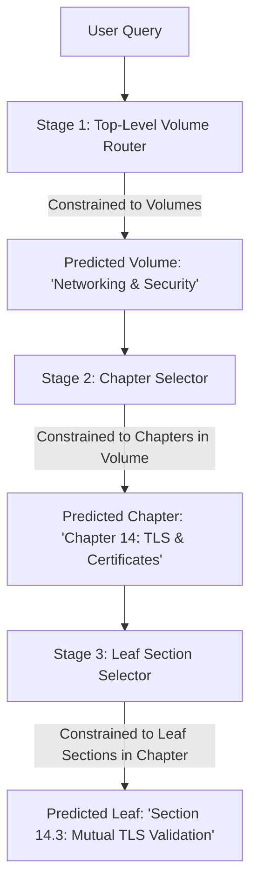

# 🔮 Future Scope & Strategic Engineering Roadmap

This document outlines the research frontiers, system optimizations, and enterprise extensions envisioned for the Structure-Aware Retriever (STAIR) architecture.

---

## 1. Roadmap Overview Matrix

| Horizon | Initiative | Primary Challenge Addressed | Target Stack |
| :--- | :--- | :--- | :--- |
| **Q1 (Near-Term)** | **Multi-Hop Leaf Retrieval** | Queries requiring information across multiple sections | Beam Search Trie Traverser |
| **Q1 (Near-Term)** | **GGUF / llama.cpp GBNF Engine** | Edge & local deployment with 0 GPU footprint | GBNF Grammars + llama.cpp |
| **Q2 (Mid-Term)** | **Coarse-to-Fine Hierarchical Pruning**| Massive 50,000+ page enterprise document libraries | Multi-Stage Nested Tries |
| **Q2 (Mid-Term)** | **Multimodal Vision STAIR** | Preserving technical architecture diagrams & tables | ColPali / Llama-3.2-Vision |
| **Q3 (Long-Term)** | **Enterprise Connectors** | Ingesting live wikis and repos (Confluence, Notion) | AST Markdown / HTML Parsers |
| **Q3 (Long-Term)** | **Distributed vLLM Serving** | Production microservice with 1,000+ req/sec | vLLM + FastAPI + Kubernetes |

---

## 2. Technical Deep-Dive into Future Capabilities

### 2.1 Multi-Hop & Composite Query Retrieval
* **Current State:** STAIR maps a query to the single best leaf section ($\text{Hit}@1$).
* **Challenge:** Complex developer queries often require synthesizing information from two disparate sections (e.g., *"How does FastAPI dependency injection in Chapter 4 manage database transaction rollbacks defined in Chapter 2?"*).
* **Proposed Architecture:**
  - Implement a **Constrained Beam Search** over the Prefix Trie that returns the top-$K$ most probable leaf paths:
    $$\mathcal{S}_{\text{top-}K} = \arg\max_{S_1, \dots, S_K} \prod_{t=1}^{|S_i|} P(y_t \mid y_{<t}, \text{Query}, \text{ToC})$$
  - Add an iterative multi-hop routing head: Section A is retrieved, appended to the dialogue context, and the model predicts whether a secondary supplementary section is required before generating the final answer.

---

### 2.2 Local Edge Deployment via GGUF & llama.cpp Grammars (GBNF)
* **Objective:** Enable STAIR to run offline on developer laptops, iOS/Android mobile apps, and edge devices with **zero GPU dependencies** and memory footprints under **1.8 GB**.
* **Technical Mechanism:**
  1. Merge the fine-tuned LoRA adapter into base Llama-3.2-3B weights:
     ```python
     merged_model = model.merge_and_unload()
     merged_model.save_pretrained("stair_llama_merged")
     ```
  2. Quantize the merged model to `Q4_K_M` GGUF format via `llama.cpp`.
  3. Compile the Table of Contents dynamically into a **GBNF (Grammar-Based Normal Form) grammar file**:
     ```ebnf
     root ::= "Section " ("1.1: Syntax" | "1.2: Iterators" | "2.1: Collections" | ...)
     ```
  4. Run inference via `llama-cpp-python`. The llama.cpp grammar sampler masks logits natively in C++ in $< 50\ \mu\text{s}$, achieving lightning-fast offline retrieval.

---

### 2.3 Coarse-to-Fine Hierarchical Pruning for Massive Manuals
* **Challenge:** When indexing an enterprise library spanning 100 volumes and 50,000 pages, the flattened Table of Contents string can exceed the model's 8K/128K context window.
* **Proposed Architecture (Multi-Stage Recursive STAIR):**



- Each stage only ingests the immediate subtree into the prompt, reducing prompt tokens from $50{,}000$ to $< 500$ tokens per hop while maintaining mathematical zero-hallucination at each branch.

---

### 2.4 Multimodal Vision STAIR (Diagrams & Tables)
* **Challenge:** Technical documentation contains critical architectural flowcharts, database ERDs, and circuit schematics that pure OCR converts into unintelligible text.
* **Proposed Architecture:**
  - Integrate visual leaf extraction using **ColPali** or **Llama-3.2-11B-Vision**.
  - During PDF extraction, associate each leaf section with high-resolution image crops of diagrams and tables embedded within that page span.
  - When STAIR retrieves `Section 4.2`, the dashboard serves both the intact markdown text and the high-resolution architecture diagram side-by-side.

---

### 2.5 Enterprise Connectors & Autonomous Sync
* **Target Platforms:** Confluence, Notion, GitHub Wiki, Sphinx, Docusaurus, MkDocs.
* **Mechanism:**
  - Instead of PDF extraction, build AST (Abstract Syntax Tree) parsers for Markdown and HTML.
  - Convert `# Header 1`, `## Header 2`, `### Header 3` directly into the STAIR ToC tree in real time.
  - Implement a GitHub Actions / Webhook worker: whenever documentation is merged to `main`, the STAIR index is automatically rebuilt and deployed without downtime.

---

### 2.6 Production Microservice & vLLM Serving
* **Containerization:** Dockerize the inference engine with an optimized CUDA runtime.
* **High-Throughput Serving:**
  - Deploy with **vLLM** using guided decoding (`outlines` regex/grammar engine integration).
  - Expose asynchronous high-performance **gRPC and FastAPI endpoints**:
    ```
    POST /v1/retrieve
    {
      "query": "How do task groups handle errors?",
      "document_id": "fastapi_manual_v2"
    }
    ```
  - Horizontal scaling via Kubernetes with HPA (Horizontal Pod Autoscaler) triggered by queue latency.
